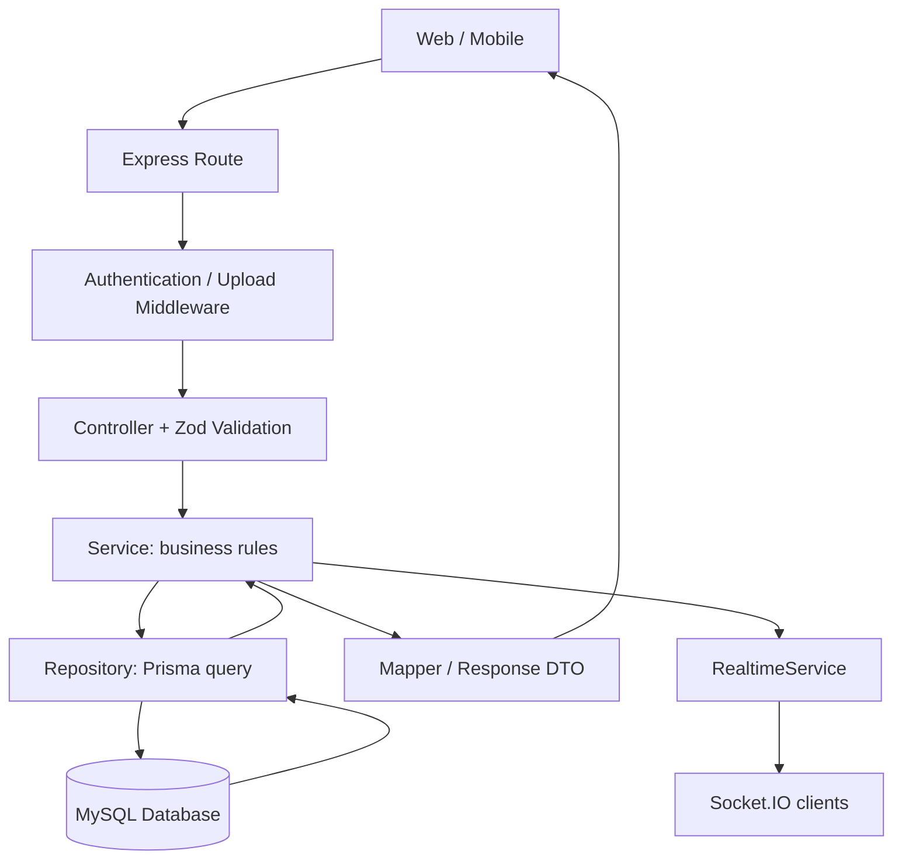

# Live Chat Backend Code ရှင်းလင်းချက်

ဒီစာတမ်းက လက်ရှိ `backend/` ထဲက code ကို အခြေခံပြီး ဘယ်ဖိုင်က ဘာလုပ်သလဲ၊ request တစ်ခု ဘယ်လိုဖြတ်သန်းသလဲဆိုတာ ရှင်းပြထားတာဖြစ်ပါတယ်။ အောက်က ဖိုင် link တွေကို ဒီစာတမ်းရှိတဲ့ folder ကနေ တိုက်ရိုက်ဖွင့်ကြည့်နိုင်ပါတယ်။

## 1. Backend ရဲ့ အဓိကအလုပ်

ဒီ backend က customer mobile app နဲ့ operator web portal နှစ်ခုလုံးအတွက် အလုပ်လုပ်ပါတယ်။ Customer တစ်ယောက်မှာ support conversation တစ်ခုရှိပြီး operator တွေက shared inbox တစ်ခုအနေနဲ့ ဝင်ကြည့်၊ reply ပြန်ပေးနိုင်ပါတယ်။

အသုံးပြုထားတဲ့ နည်းပညာတွေက—

| နည်းပညာ | ဒီ project မှာ ဘာအတွက်သုံးလဲ |
| --- | --- |
| Node.js + TypeScript | Server program နဲ့ type checking |
| Express 5 | HTTP REST API |
| Socket.IO | Message၊ reaction၊ typing၊ online status ကို realtime ပို့ခြင်း |
| Prisma + MariaDB adapter | MySQL database ကို query လုပ်ခြင်း |
| Zod | Request body နဲ့ query parameters စစ်ခြင်း |
| JSON Web Token | Login ဝင်ထားသူကို ခွဲခြားခြင်း |
| bcryptjs | Operator password ကို hash လုပ်၊ စစ်ခြင်း |
| Multer | Multipart file upload လက်ခံခြင်း |
| sharp | Image resize၊ WebP ပြောင်းခြင်း၊ thumbnail ထုတ်ခြင်း |

## 2. Folder တစ်ခုချင်းစီရဲ့တာဝန်

```text
backend/
├── package.json             Run/build/database command များ
├── prisma.config.ts         Prisma CLI အတွက် schema နဲ့ DB configuration
├── prisma/
│   ├── schema.prisma        Table၊ relation၊ index သတ်မှတ်ချက်များ
│   └── migrations/          Database structure ပြောင်းထားသော SQL များ
├── src/
│   ├── index.ts             Server စဖွင့်သည့် entry point
│   ├── app.ts               Express middleware နဲ့ route ချိတ်ဆက်ခြင်း
│   ├── container.ts         Service နဲ့ repository instance များ ချိတ်ဆက်ခြင်း
│   ├── config/env.ts        Environment variables ဖတ်ခြင်း
│   ├── routes/             URL နဲ့ controller ချိတ်ခြင်း
│   ├── middlewares/        Authentication၊ upload၊ error handling
│   ├── controllers/        HTTP input လက်ခံ၊ service ခေါ်၊ response ပြန်ပို့ခြင်း
│   ├── validators/         Input validation schema များ
│   ├── services/           Application ရဲ့ business rule များ
│   ├── repositories/       Database query များ
│   ├── mappers/            Database row → client သုံးမည့် response ပုံစံ
│   ├── socket/             Socket connection နဲ့ event handler များ
│   ├── lib/prisma.ts       Database client instance
│   ├── contracts.ts        API/socket data type သတ်မှတ်ချက်များ
│   ├── types/              Backend သုံး authentication နဲ့ socket type များ
│   ├── utils/HttpError.ts   HTTP status ပါသော application error
│   └── generated/prisma/   Prisma က schema အတိုင်း ထုတ်ပေးသော code
└── uploads/                 သိမ်းထားသော image/video ဖိုင်များ
```

`generated/prisma/` က generated code ဖြစ်ပါတယ်။ Table ပြောင်းချင်ရင် ဒီ folder ကို တိုက်ရိုက်ပြင်မယ့်အစား `schema.prisma` ပြင်ပြီး Prisma client ပြန် generate လုပ်ရပါတယ်။

## 3. Request တစ်ခု ဘယ်လိုအလုပ်လုပ်လဲ



ဥပမာ reaction ပေးတဲ့ HTTP request ဆိုရင်—

```text
POST /api/messages/:messageId/reactions
  → requireActor: token စစ်
  → reactionController.toggle: emoji စစ်
  → ReactionService.toggle: message ကို access ရှိမရှိ စစ်
  → ReactionRepository.toggle: reaction ကို transaction နဲ့ ပြောင်း
  → summarizeReactions: emoji အလိုက် count နဲ့ actorKeys ဖွဲ့
  → RealtimeService.reactionUpdated: နှစ်ဖက်ကို event ပို့
  → controller: JSON response ပြန်
```

Layer ခွဲထားတဲ့ အကျိုးက HTTP နဲ့ Socket.IO နှစ်မျိုးလုံးက service တစ်ခုတည်းကို ပြန်သုံးနိုင်တာပါ။ Reaction rule ပြောင်းချင်ရင် HTTP controller နဲ့ socket handler နှစ်ခုမှာ business logic ထပ်ရေးစရာမလိုပါ။

## 4. Server စဖွင့်သည့် code

### `src/index.ts`

[Code ဖွင့်ရန်](src/index.ts)

Server startup အစဉ်က—

1. `mediaService.init()` နဲ့ upload folder ဖန်တီးပါတယ်။
2. `authService.ensureInitialAdmin()` နဲ့ operator table လုံးဝဗလာဖြစ်ရင် ပထမ admin ဖန်တီးပါတယ်။
3. `createApp()` နဲ့ Express app တည်ဆောက်ပါတယ်။
4. `createServer()` နဲ့ HTTP server တည်ဆောက်ပါတယ်။
5. `createSocketServer(httpServer)` နဲ့ HTTP server တစ်ခုတည်းပေါ် Socket.IO ချိတ်ပါတယ်။
6. `httpServer.listen(env.port)` နဲ့ request စလက်ခံပါတယ်။ Default port က `4000` ဖြစ်ပါတယ်။

`SIGINT` / `SIGTERM` ရရင် HTTP server ပိတ်၊ Prisma disconnect လုပ်ပြီး process ထွက်ပါတယ်။

### `src/app.ts`

[Code ဖွင့်ရန်](src/app.ts)

Middleware အစီအစဉ်က—

```ts
app.use(cors({ origin: env.clientOrigin }));
app.use(express.json());
app.use('/uploads', express.static(/* upload directory */));
app.use('/api', router);
app.use(notFound);
app.use(errorHandler);
```

`express.json()` က JSON body ကို `req.body` အဖြစ် ဖတ်ပေးပါတယ်။ `/api` အောက်က URL တွေကို router ဆီပို့ပြီး `/uploads/...` က သိမ်းထားတဲ့ media ဖိုင်တွေကို ပြပေးပါတယ်။ Route မရှိရင် `notFound`၊ error ဖြစ်ရင် `errorHandler` ကို ရောက်ပါတယ်။

### `src/container.ts`

[Code ဖွင့်ရန်](src/container.ts)

ဒီဖိုင်က object တွေ တည်ဆောက်ပြီး လိုအပ်တဲ့ dependency တွေကို constructor မှာ ထည့်ပေးပါတယ်။

```ts
export const reactionService = new ReactionService(
  reactionRepository,
  messageRepository,
  realtimeService,
);
```

အဓိပ္ပါယ်က `ReactionService` က reaction query၊ message query၊ realtime ပို့ခြင်းတို့ကို သုံးဖို့ သက်ဆိုင်ရာ object တွေ ရထားတာပါ။ `new` လုပ်တဲ့အချိန်မှာ constructor က အဲဒီ object တွေကို လက်ခံသိမ်းထားပါတယ်။

## 5. Database table များ

[Schema ဖွင့်ရန်](prisma/schema.prisma)

| Table | သိမ်းထားသောအရာ | အဓိက relation / rule |
| --- | --- | --- |
| `Operator` | ဝန်ထမ်း account၊ password hash၊ role၊ active status | Email unique ဖြစ်ပြီး message ပို့၊ conversation assign ခံနိုင် |
| `Customer` | Customer name၊ phone | Phone unique ဖြစ်ပြီး conversation တစ်ခုရှိနိုင် |
| `Conversation` | Support thread၊ status၊ assignee၊ unread count၊ last message preview | `customerId` unique ဖြစ်လို့ customer တစ်ယောက်မှာ conversation တစ်ခုပဲ |
| `Message` | စာသား၊ sender type၊ conversation ID | Conversation တစ်ခုအောက်မှာ message များစွာရှိနိုင် |
| `Attachment` | Image/video URL၊ size၊ dimensions၊ position | Message တစ်ခုအောက်မှာ attachment များစွာရှိနိုင် |
| `Reaction` | Emoji၊ actor type၊ actor ID | Message တစ်ခုမှာ actor တစ်ယောက်လျှင် reaction တစ်ခုပဲ |

`ActorType` က `OPERATOR` နဲ့ `CUSTOMER` ကို ခွဲပါတယ်။ `Reaction.actorId` က polymorphic identifier ဖြစ်ပြီး Operator/Customer နှစ်ခုဆီ foreign key တိုက်ရိုက်ချိတ်ထားခြင်းမရှိပါ။ ဘယ် table ရဲ့ ID ဆိုတာကို `actorType` နဲ့ တွဲဖတ်ရပါတယ်။

`lib/prisma.ts` က `PrismaMariaDb` adapter နဲ့ Prisma client တစ်ခုကို တည်ဆောက်ပါတယ်။ Schema provider က `mysql` ဖြစ်ပြီး adapter အတွက် connection URL အစကို `mysql://` ကနေ `mariadb://` ပြောင်းသုံးထားပါတယ်။

## 6. Login နဲ့ authentication

သက်ဆိုင်ရာဖိုင်များ—[Controller](src/controllers/auth.controller.ts)၊ [Auth service](src/services/auth.service.ts)၊ [Token service](src/services/token.service.ts)၊ [Middleware](src/middlewares/auth.ts)။

### Operator login

```text
email + password
  → Zod နဲ့ input စစ်
  → OperatorRepository.findByEmail()
  → bcrypt.compare() နဲ့ password hash စစ်
  → isActive စစ်
  → TokenService.sign()
  → token + operator DTO ပြန်
```

Password ကို plaintext နဲ့ မသိမ်းပါ။ `hashPassword()` က bcrypt cost `10` နဲ့ hash လုပ်ပါတယ်။ Email မရှိတဲ့အခါလည်း dummy hash နဲ့ compare လုပ်ထားတာက email ရှိ/မရှိကို response time ကနေ အလွယ်တကူ ခန့်မှန်းမရစေဖို့ပါ။

### Customer login

လက်ရှိ code မှာ `name` နဲ့ `phone` ကို လက်ခံပြီး `upsertByPhone()` လုပ်ပါတယ်။ Phone ရှိပြီးသားဆို name ပြန်ပြင်၊ မရှိသေးရင် customer ဖန်တီးပါတယ်။ ပြီးရင် conversation ရှိအောင် `ensureForCustomer()` ခေါ်ပြီး token ထုတ်ပေးပါတယ်။

ဒီ flow မှာ password သို့မဟုတ် OTP စစ်ခြင်း မပါပါ။ Phone ကို ထည့်သွင်းခြင်းက ဖုန်းပိုင်ရှင်ဖြစ်ကြောင်း အတည်ပြုခြင်း မဟုတ်တာကို code နားလည်ရာမှာ ခွဲသိထားရပါမယ်။

### JWT ထဲမှာ ဘာပါလဲ

```ts
{ sub: accountId, typ: 'OPERATOR' /* or CUSTOMER */, ver: tokenVersion }
```

`sub` က account ID၊ `typ` က actor type၊ `ver` က account ရဲ့ token version ပါ။ JWT ကို `HS256` နဲ့ sign လုပ်ပြီး issuer ကို `live-chat` သတ်မှတ်ထားပါတယ်။ Expiry ကို environment variable ကနေ သတ်မှတ်ပါတယ်။

HTTP request က token ကို ဒီလိုပို့ရပါတယ်—

```http
Authorization: Bearer <token>
```

`authenticate()` က signature နဲ့ expiry စစ်ပြီး database က account ကို ပြန်ဖတ်ပါတယ်။ Token ထဲက `ver` နဲ့ DB ထဲက `tokenVersion` မတူရင် `Token revoked` ဖြစ်ပါတယ်။ Operator inactive ဖြစ်ရင်လည်း reject လုပ်ပါတယ်။

| Middleware | ခွင့်ပြုသူ |
| --- | --- |
| `requireActor` | Login ဝင်ထားသော customer သို့မဟုတ် operator |
| `requireOperator` | Operator သာ |
| `requireAdmin` | ADMIN role ရှိသော operator သာ |
| `requireCustomer` | Customer သာ |

Login အောင်မြင်မှု response status က လက်ရှိ controller မှာ `201` ဖြစ်ပါတယ်။ Logout endpoint က `204` ပြန်ပြီး token version မတိုးပါ။ ပုံမှန် logout မှာ client က token ကို ဖျက်ပစ်ရပါတယ်။

## 7. Conversation၊ inbox နဲ့ unread count

[Service](src/services/conversation.service.ts) နဲ့ [Repository](src/repositories/conversation.repository.ts) ကို တွဲဖတ်ပါ။

`resolve(actor, conversationId)` က customer ဆို ကိုယ့် conversation ကိုပဲ resolve လုပ်ပေးပြီး အခြား conversation ID ပေးလာရင် reject လုပ်ပါတယ်။ Operator ဆို conversation ID လိုအပ်ပြီး ရှိတဲ့ conversation ကို ရှာပေးပါတယ်။

Inbox ရဲ့ filter များ—

| Filter | Query အလုပ်လုပ်ပုံ |
| --- | --- |
| `all` | Message ရှိပြီး `OPEN` ဖြစ်နေသော conversation များ |
| `unread` | `OPEN` ဖြစ်ပြီး `unreadByOperators > 0` |
| `mine` | `OPEN` ဖြစ်ပြီး လက်ရှိ operator ကို assign လုပ်ထားသော conversation များ |
| `done` | `DONE` ဖြစ်သော conversation များ |

`all` ဆိုတာ DONE ပါဝင်တဲ့ conversation အားလုံးကို ဆိုလိုခြင်းမဟုတ်ပါ။ လက်ရှိ code မှာ default status က `OPEN` ဖြစ်ပါတယ်။ Search က customer name သို့မဟုတ် phone မှာ ရှာပါတယ်။

`recordMessage()` က message ပို့ပြီးတိုင်း inbox metadata ကို ပြောင်းပါတယ်—

| Sender | ပြောင်းလဲမှု |
| --- | --- |
| Customer | `unreadByOperators + 1`၊ `unreadByCustomer = 0`၊ `customerLastReadAt` ပြောင်း၊ conversation ကို `OPEN` ပြန်လုပ် |
| Operator | `unreadByCustomer + 1`၊ `unreadByOperators = 0`၊ `operatorLastReadAt` ပြောင်း |

Unread count က operator တစ်ယောက်ချင်းစီအတွက် မခွဲထားပါ။ Operator ဘက်အတွက် shared count ဖြစ်တဲ့အတွက် operator တစ်ယောက် read လုပ်ရင် operator ဘက် unread count ကို သုညပြန်ထားပါတယ်။

`markRead()` က DB ပြောင်းပြီး `read:update` နဲ့ `conversation:updated` event ပို့ပါတယ်။ Assignee ပြောင်းတဲ့အခါလည်း active operator ဖြစ်မဖြစ် စစ်ပါတယ်။

## 8. Message ပို့ခြင်း

[Message service](src/services/message.service.ts)၊ [Repository](src/repositories/message.repository.ts)၊ [Controller](src/controllers/message.controller.ts)။

Text-only message တွေကို အများအားဖြင့် `message:send` socket event နဲ့ပို့ပါတယ်။ Photo/video ပါရင် HTTP multipart endpoint နဲ့ ပို့ပါတယ်။ နှစ်မျိုးလုံး နောက်ဆုံးမှာ `MessageService.send()` ကို ခေါ်ပါတယ်။

`send()` ရဲ့ အလုပ်အစဉ်—

1. `ConversationService.resolve()` နဲ့ access စစ်ပါတယ်။
2. Text လည်းမရှိ၊ attachment လည်းမရှိရင် reject လုပ်ပါတယ်။
3. `MediaService.processUploads()` နဲ့ attachment ပြင်ဆင်ပါတယ်။
4. `MessageRepository.create()` နဲ့ message၊ attachment metadata တွေ သိမ်းပါတယ်။
5. `toMessageDto()` နဲ့ client သုံးနိုင်တဲ့ response ဖွဲ့ပါတယ်။
6. `ConversationRepository.recordMessage()` နဲ့ preview၊ unread count၊ last activity ပြောင်းပါတယ်။
7. `message:new` နဲ့ `conversation:updated` event ပို့ပါတယ်။

Attachment metadata တွေကို message create ရဲ့ nested write နဲ့ သိမ်းပါတယ်။ ဒါပေမယ့် **message create နဲ့ conversation metadata update နှစ်ခုလုံးကို transaction တစ်ခုထဲ မထည့်ထားပါ**။ Message save အောင်မြင်ပြီး metadata update မှာ error ဖြစ်ရင် message row ကျန်နိုင်ပါတယ်။ ဒါက လက်ရှိ code ရဲ့ အလုပ်လုပ်ပုံကို ဖတ်တဲ့အခါ သိထားရမယ့်အချက်ပါ။

Message list က cursor pagination သုံးပါတယ်။ `limit + 1` ခုယူပြီး next page ရှိမရှိ စစ်ပါတယ်။ Database က newest first ယူပေမယ့် client ကိုပို့မယ့် page ထဲမှာ oldest first ပြန်စီပါတယ်။ နောက်ထပ်အဟောင်းတွေယူဖို့ `nextCursor` ကို နောက် request ရဲ့ `before` အဖြစ်ပို့ရပါတယ်။

## 9. Reaction တစ်ခုပဲ ပေးနိုင်အောင်ရေးထားသည့် code

[Service](src/services/reaction.service.ts) နဲ့ [Repository](src/repositories/reaction.repository.ts)။

### Service က access နဲ့ realtime ကို ကိုင်တွယ်တယ်

`ReactionService.toggle()` က message ရှိမရှိ စစ်ပါတယ်။ Customer က တခြား customer ရဲ့ message ကို reaction ပေးလာရင် `404 Message not found` ပြန်ပါတယ်။ ပြီးရင် authenticated actor ရဲ့ ID ကို ကိုယ်တိုင်ရွေးယူတာဖြစ်လို့ client က သူတစ်ပါး `actorId` ထည့်ပြီး reaction ပေးလို့မရပါ။

Repository ပြောင်းပြီးနောက် message ရဲ့ reaction အားလုံးကို ပြန်ဖတ်၊ summary ဖွဲ့ပြီး `reaction:update` event ပို့ပါတယ်။

### Database unique constraint

```prisma
@@unique([messageId, actorType, actorId])
```

အဲဒီ field သုံးခုတူတဲ့ row နှစ်ခု မသိမ်းနိုင်ပါ။ Emoji ကို unique key ထဲ မထည့်ထားတဲ့အတွက် emoji မတူလည်း actor တစ်ယောက်က message တစ်ခုမှာ reaction တစ်ခုပဲရှိနိုင်ပါတယ်။ Customer နဲ့ operator ID တူခဲ့ရင်တောင် `actorType` မတူလို့ သီးခြားလူအနေနဲ့ ခွဲထားပါတယ်။

### Transaction ထဲက toggle logic

```ts
return prisma.$transaction(async (tx) => {
  await tx.$queryRaw`SELECT id FROM Message WHERE id = ${messageId} FOR UPDATE`;
  const key = { messageId, actorType, actorId };
  const existing = await tx.reaction.findUnique({
    where: { messageId_actorType_actorId: key },
  });

  if (existing?.emoji === emoji) {
    await tx.reaction.delete({ where: { id: existing.id } });
    return false;
  }

  await tx.reaction.upsert({
    where: { messageId_actorType_actorId: key },
    create: { ...key, emoji },
    update: { emoji },
  });
  return true;
});
```

ဒီ code ကို အပိုင်းလိုက်ဖတ်ရင်—

1. `$transaction` က အတွင်း DB အလုပ်တွေကို အောင်မြင်ရင် commit၊ error ဖြစ်ရင် rollback လုပ်ပါတယ်။
2. `FOR UPDATE` က message row ကို transaction ပြီးတဲ့အထိ lock လုပ်ထားပါတယ်။ တူညီတဲ့ message ကို reaction request တစ်ပြိုင်နက် ဝင်လာရင် ဒီ repository က toggle တွေ အလှည့်ကျ အလုပ်လုပ်ရပါတယ်။ Reaction row မရှိသေးတဲ့အချိန်မှာလည်း parent message ကို lock လုပ်နိုင်ပါတယ်။
3. `findUnique` က ဒီ actor ရဲ့ လက်ရှိ reaction ကို ရှာပါတယ်။
4. Emoji တူရင် delete လုပ်ပါတယ်။ ဒါက reaction ဖြုတ်ခြင်းပါ။
5. Emoji မတူရင် `upsert` လုပ်ပါတယ်။ Row မရှိရင် create၊ ရှိရင် emoji ပြောင်းပါတယ်။

ဥပမာ—

| လက်ရှိ reaction | နှိပ်လိုက်သော emoji | ရလဒ် |
| --- | --- | --- |
| မရှိ | 👍 | 👍 တစ်ခုရှိလာ |
| 👍 | ❤️ | 👍 ပျောက်ပြီး ❤️ ဖြစ်လာ |
| ❤️ | ❤️ | Reaction ဖြုတ် |

တခြား user ရဲ့ reaction ကို မဖျက်ပါ။ ဥပမာ customer နဲ့ operator နှစ်ယောက်လုံး 👍 ပေးထားရင် count `2` ဖြစ်တာ မှန်ပါတယ်။ တစ်ယောက်တည်းက emoji နှစ်မျိုး တစ်ပြိုင်နက်ပေးထားတာကိုပဲ တားထားတာပါ။

Migration [20261031060000_single_reaction_per_actor](prisma/migrations/20261031060000_single_reaction_per_actor/migration.sql) က ရှိပြီးသား duplicate တွေထဲက latest `createdAt` ရှိတာကို ထားပါတယ်။ Timestamp တူရင် ID နှိုင်းယှဉ်ပြီး row တစ်ခုပဲထားကာ unique index အသစ် ထည့်ပါတယ်။

## 10. Socket.IO realtime အလုပ်လုပ်ပုံ

[Socket handlers](src/socket/index.ts) နဲ့ [Realtime service](src/services/realtime.service.ts)။

Connection ဝင်လာရင် `socket.handshake.auth.token` ကို `authenticate()` နဲ့ စစ်ပြီး actor ကို `socket.data.actor` မှာ သိမ်းထားပါတယ်။

| Room | ပါဝင်သူ |
| --- | --- |
| `operators` | Operator socket အားလုံး |
| `operator:<id>` | သတ်မှတ် operator ရဲ့ device/tab များ |
| `customers` | Customer socket အားလုံး၊ operator online status ပို့ရာမှာသုံး |
| `customer:<id>` | သတ်မှတ် customer ရဲ့ device များ |

Message၊ reaction နဲ့ read event ကို operator အားလုံးနဲ့ သက်ဆိုင်ရာ customer ကိုပဲ ပို့ပါတယ်။ အခြား customer တွေဆီ မပို့ပါ။ `conversation:updated` ကို operator inbox တွေဆီပဲ ပို့ပါတယ်။

### Client → Server

| Event | Payload | Handler ရဲ့အလုပ် |
| --- | --- | --- |
| `message:send` | `{ conversationId?, content }` | Validate → message service → acknowledgement |
| `reaction:toggle` | `{ messageId, emoji }` | Validate → reaction service → acknowledgement |
| `conversation:read` | `{ conversationId? }` | Read state ပြောင်း |
| `typing:start` | `{ conversationId? }` | Typing စတင် |
| `typing:stop` | `{ conversationId? }` | Typing ရပ် |

Customer အတွက် ကိုယ့် conversation ကို server က resolve လုပ်ပေးလို့ `conversationId` မပို့လည်းရပါတယ်။ Operator အတွက် လိုအပ်ပါတယ်။

### Server → Client

| Event | အသုံးပြုပုံ |
| --- | --- |
| `message:new` | Message list ထဲ message အသစ်ထည့် |
| `reaction:update` | Message ရဲ့ reaction summary အစားထိုး |
| `conversation:updated` | Operator inbox row ပြင် |
| `read:update` | Read/seen marker ပြင် |
| `typing:update` | Typing indicator ပြင် |
| `presence:update` | Online status ပြင် |

Acknowledgement ဆိုတာ event ပို့တဲ့ client ကို အဲဒီ request ရဲ့ result ပြန်ပေးခြင်းပါ။ Broadcast ကတော့ သက်ဆိုင်ရာ connected client တွေအားလုံးကို ပြောင်းလဲမှုအသိပေးခြင်းပါ။ Client တစ်ခုက နှစ်မျိုးလုံးရနိုင်တာကြောင့် message ID နဲ့ duplicate မဖြစ်အောင် client ဘက်မှာ ကိုင်တွယ်ရပါတယ်။

Socket authentication ကို connection စဝင်ချိန်မှာ လုပ်ပါတယ်။ Event တိုင်း JWT expiry ကို ပြန်စစ်ထားတာတော့ မဟုတ်ပါ။ Operator deactivate/password reset လုပ်တဲ့ flow မှာတော့ သက်ဆိုင်ရာ operator socket တွေကို disconnect လုပ်ထားပါတယ်။

## 11. Online status နဲ့ typing

[Presence service](src/services/presence.service.ts) က database အစား memory ထဲက `Map` နဲ့ `Set` တွေသုံးပါတယ်။

User တစ်ယောက်မှာ tab/device များနိုင်လို့ socket ID တွေကို `Set` နဲ့ သိမ်းပါတယ်။ ပထမ socket ဝင်ရင် online ဖြစ်ပြီး နောက်ဆုံး socket ထွက်မှ offline ဖြစ်ပါတယ်။ Typing ကို conversation ID နဲ့ actor key အလိုက် သိမ်းပါတယ်။

Customer ဆီ `presence:update` ပို့တဲ့အခါ အခြား customer ID စာရင်းကို ဖယ်ထားပါတယ်။ Operator တွေကတော့ full snapshot ရပါတယ်။

Memory state ဖြစ်လို့ server restart လုပ်ရင် reset ဖြစ်ပါတယ်။ လက်ရှိ implementation က server process တစ်ခုအတွင်း state ကိုပဲ သိပါတယ်။ Typing state ကို client က stop ပို့တဲ့အခါ၊ message ပို့ပြီးတဲ့အခါ၊ နောက်ဆုံး socket disconnect ဖြစ်တဲ့အခါ ဖြုတ်ပေးပါတယ်။ Server ဘက်မှာ typing expiry timer သီးခြား မပါပါ။

## 12. Image/video upload

[Upload middleware](src/middlewares/upload.ts) နဲ့ [Media service](src/services/media.service.ts)။

```text
multipart field: files
  → Multer: MIME type၊ file count၊ upper size limit စစ်
  → OS temporary folder မှာ ဖိုင်လက်ခံ
  → Controller: content validate
  → MessageService: conversation access စစ်
  → MediaService: image ပြောင်း / video copy
  → uploads/ မှာ သိမ်း
  → Attachment table မှာ metadata သိမ်း
```

Image ကို auto rotate လုပ်ပြီး အကြီးဆုံး dimension `1920` အတွင်း fit ဖြစ်အောင် resize လုပ်ပါတယ်။ Main image ကို WebP quality `80`၊ thumbnail ကို dimension `480` အတွင်း WebP quality `70` နဲ့ ထုတ်ပါတယ်။ Image အသေးကို အတင်းချဲ့မထားပါ။

Video က transcoding မလုပ်ပါ။ Upload လုပ်ထားတဲ့ data ကို ဖိုင်နာမည်အသစ်နဲ့ copy လုပ်သိမ်းပါတယ်။ Video thumbnail နဲ့ width/height ကို လက်ရှိ code က မထုတ်ပေးပါ။

Default limit က image `15 MB`၊ video `100 MB`၊ message တစ်ခုမှာ file `10` ခု ဖြစ်ပါတယ်။ Environment နဲ့ ပြောင်းနိုင်ပါတယ်။ Temp file တွေကို processing ပြီးရင် cleanup လုပ်ပါတယ်။ သိမ်းပြီးသား attachment တွေ DB write အဆင့်မှာ error ဖြစ်ရင် ဖျက်ရန် cleanup path ပါပါတယ်။

Stored file URL က `/uploads/<uuid>.webp` ပုံစံပါ။ လက်ရှိ static route မှာ authentication middleware မထည့်ထားလို့ file URL သိရင် login မလိုဘဲ ဖွင့်နိုင်ပါတယ်။

## 13. Validation၊ mapper နဲ့ error handling

### `validators/index.ts`

[Code ဖွင့်ရန်](src/validators/index.ts)

Zod schema တွေက data type၊ length၊ allowed value စစ်ပြီး အချို့ input တွေ normalize လုပ်ပါတယ်။ ဥပမာ email ကို lowercase၊ phone ထဲက space နဲ့ hyphen တွေ ဖယ်ပါတယ်။

Message text အများဆုံး `2000` characters၊ operator အသစ် password က `8–72` characters၊ inbox limit default `25` / max `50`၊ message limit default `30` / max `100` ဖြစ်ပါတယ်။ Reaction string က pictographic emoji နဲ့ အစပြုရမယ်လို့ စစ်ထားတာဖြစ်ပြီး picker ထဲက emoji စာရင်းတစ်ခုတည်းကိုသာ ခွင့်ပြုတဲ့ whitelist မဟုတ်ပါ။

### `mappers/index.ts`

[Code ဖွင့်ရန်](src/mappers/index.ts)

DTO ဆိုတာ client ကိုပို့မယ့် data ပုံစံပါ။ Prisma row အတိုင်း အကုန်မပို့ဘဲ mapper နဲ့ လိုတာပဲရွေးပါတယ်။ `toOperatorDto()` မှာ password hash နဲ့ token version မပါပါ။ Date တွေကို ISO string ပြောင်းပါတယ်။

`summarizeReactions()` က reaction row တွေကို emoji အလိုက် အုပ်စုဖွဲ့ပါတယ်—

```json
[
  {
    "emoji": "👍",
    "count": 2,
    "actorKeys": ["CUSTOMER:customer-id", "OPERATOR:operator-id"]
  }
]
```

`actorKeys` ကို client က ကိုယ့် reaction ဟုတ်မဟုတ် highlight လုပ်ရာမှာ သုံးနိုင်ပါတယ်။ `messagePreview()` က text ကို inbox preview အဖြစ်တိုစေပြီး attachment-only ဖြစ်ရင် photo/video preview စာသား ထုတ်ပါတယ်။

### `middlewares/errorHandler.ts` နဲ့ `utils/HttpError.ts`

| Error | HTTP response |
| --- | --- |
| Zod input error | `400`၊ validation message နဲ့ issues |
| Multer upload error | `400`၊ upload error message |
| `HttpError` | Error ထဲမှာ သတ်မှတ်ထားသော status/message |
| မသိသော error | Server console မှာ log၊ client ကို `500` နဲ့ `Internal server error` |
| မရှိသော route | `404` နဲ့ `Route not found` |

Socket handler တွေမှာတော့ HTTP status အစား acknowledgement ထဲ `{ ok: false, error: '...' }` ပြန်ပါတယ်။ မသိတဲ့ socket error ကို server မှာ log လုပ်ပြီး client ကို `Something went wrong` လို့ ပြန်ပါတယ်။

## 14. Operator account စီမံခန့်ခွဲခြင်း

[Operator service](src/services/operator.service.ts) က create/update rule တွေ ကိုင်တွယ်ပါတယ်။ List ကို operator တွေကြည့်နိုင်ပြီး create/update က admin-only route ဖြစ်ပါတယ်။

Create မှာ email မထပ်မိအောင်စစ်၊ password hash လုပ်ပြီး သိမ်းပါတယ်။ Update မှာ နောက်ဆုံး active admin ကို deactivate/demote မလုပ်နိုင်အောင်နဲ့ ကိုယ့် account ကိုယ် deactivate မလုပ်နိုင်အောင် စစ်ပါတယ်။

Deactivate သို့မဟုတ် password reset လုပ်ရင် repository က `tokenVersion` တိုးပါတယ်။ ပြီးရင် realtime service က သက်ဆိုင်ရာ operator ရဲ့ socket တွေကို disconnect လုပ်ပါတယ်။ Token အဟောင်းနဲ့ HTTP request ပြန်လာရင်လည်း version မတူလို့ authenticate မအောင်တော့ပါ။

## 15. REST API စာရင်း

URL အားလုံးက `/api` အောက်မှာ ရှိပါတယ်။ အတိအကျ route သတ်မှတ်ချက်ကို [routes/index.ts](src/routes/index.ts) မှာ ကြည့်နိုင်ပါတယ်။

| Method | Path | Access / ရည်ရွယ်ချက် |
| --- | --- | --- |
| GET | `/api/health` | Public health check၊ `{ ok: true }` |
| POST | `/api/operator/auth/login` | Public၊ operator login |
| POST | `/api/customer/auth/login` | Public၊ customer login |
| GET | `/api/auth/me` | Actor၊ လက်ရှိ account |
| POST | `/api/auth/logout` | Actor၊ logout response |
| POST | `/api/operator/auth/logout` | Operator logout |
| POST | `/api/customer/auth/logout` | Customer logout |
| GET | `/api/operators` | Operator list |
| POST | `/api/operators` | Admin၊ operator ဖန်တီး |
| PATCH | `/api/operators/:id` | Admin၊ operator ပြင် |
| GET | `/api/conversations` | Operator inbox |
| GET | `/api/conversations/:id` | Operator၊ conversation detail |
| PATCH | `/api/conversations/:id` | Operator၊ status/assignee ပြင် |
| POST | `/api/conversations/:id/read` | Operator၊ read မှတ် |
| GET | `/api/conversations/:id/messages` | Operator၊ messages ယူ |
| POST | `/api/conversations/:id/messages` | Operator၊ text/media message ပို့ |
| GET | `/api/customer/conversation` | Customer၊ ကိုယ့် conversation |
| POST | `/api/customer/conversation/read` | Customer၊ read မှတ် |
| GET | `/api/customer/conversation/messages` | Customer၊ messages ယူ |
| POST | `/api/customer/conversation/messages` | Customer၊ text/media message ပို့ |
| POST | `/api/messages/:messageId/reactions` | Actor၊ reaction toggle |

Health endpoint က DB query မလုပ်ပါ။ `{ ok: true }` ပြန်တာဟာ HTTP app တုံ့ပြန်နိုင်တယ်ဆိုတာဖြစ်ပြီး DB connection ကောင်းတယ်လို့ စစ်ပြီးသား မဟုတ်ပါ။

## 16. Environment configuration နဲ့ command များ

[Config code](src/config/env.ts) က `.env` ကိုဖတ်ပါတယ်။ အောက်ကစာရင်းက variable နာမည်နဲ့ default ပဲဖြစ်ပြီး လက်ရှိ `.env` ထဲက secret value တွေ မဟုတ်ပါ။

| Variable | အသုံးပြုပုံ / default |
| --- | --- |
| `DATABASE_URL` | Database connection URL၊ မရှိရင် error |
| `JWT_SECRET` | Token signing secret၊ မရှိရင် error |
| `PORT` | HTTP/socket port၊ `4000` |
| `CLIENT_ORIGIN` | Browser CORS origin၊ `http://localhost:5173` |
| `OPERATOR_TOKEN_TTL` | Operator token expiry၊ `12h` |
| `CUSTOMER_TOKEN_TTL` | Customer token expiry၊ `30d` |
| `UPLOAD_DIR` | Media folder၊ `uploads` |
| `MAX_IMAGE_MB` | Image limit၊ `15` |
| `MAX_VIDEO_MB` | Video limit၊ `100` |
| `MAX_FILES_PER_MESSAGE` | File count limit၊ `10` |
| `ADMIN_EMAIL` | ပထမ admin ဖန်တီးရာတွင်သုံး |
| `ADMIN_PASSWORD` | ပထမ admin password |
| `ADMIN_NAME` | ပထမ admin display name |

Project root ကနေ backend folder ထဲဝင်ပြီး run နိုင်ပါတယ်—

```bash
cd backend
npm install
npm run db:deploy
npm run db:generate
npm run dev
```

`npm install` ရဲ့ `postinstall` မှာလည်း Prisma generate လုပ်ထားပါတယ်။ Database server နဲ့ `.env` configuration က ကြိုတင်ရှိရပါမယ်။

| Command | အလုပ် |
| --- | --- |
| `npm run dev` | `tsx watch` နဲ့ source ပြောင်းရင် server ပြန်စ |
| `npm run typecheck` | TypeScript error စစ်၊ output မထုတ် |
| `npm run build` | TypeScript ကို `dist/` ထဲ compile |
| `npm start` | Build လုပ်ထားသော `dist/index.js` ကို run |
| `npm run db:migrate` | Development migration ဖန်တီး/apply လုပ်ပြီး client generate |
| `npm run db:deploy` | ရှိပြီးသား migration တွေ apply |
| `npm run db:generate` | Schema အတိုင်း Prisma client ထုတ် |
| `npm run db:studio` | Database ကြည့်ရန် Prisma Studio ဖွင့် |

## 17. Code ဖတ်ရန် အကြံပြုအစဉ်

အရင်ဆုံး [index.ts](src/index.ts) → [app.ts](src/app.ts) → [routes/index.ts](src/routes/index.ts) ကို ဖတ်ပါ။ ပြီးရင် feature တစ်ခုရွေးပြီး controller → service → repository → schema အတိုင်း လိုက်ဖတ်ပါ။

ဥပမာ reaction ကို နားလည်ချင်ရင်—

```text
routes/index.ts
  → middlewares/auth.ts
  → controllers/reaction.controller.ts
  → validators/index.ts: reactionSchema
  → services/reaction.service.ts
  → repositories/reaction.repository.ts
  → prisma/schema.prisma: Reaction
  → mappers/index.ts: summarizeReactions
  → services/realtime.service.ts: reactionUpdated
```

Socket နဲ့ပို့တဲ့ reaction အတွက် အစပိုင်း route/controller အစား `socket/index.ts` ထဲက `reaction:toggle` ကိုဖတ်ပါ။ အဲဒီနောက်ပိုင်း service၊ repository နဲ့ database rule က တူပါတယ်။
